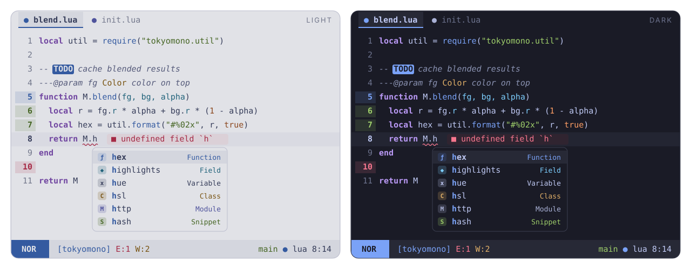

<p align="center">
  
</p>

# TokyoMono

A quieter [TokyoNight](https://github.com/folke/tokyonight.nvim), built on the
structure of [onemono](https://github.com/amonteirom96/onemono.nvim) for the
plugins in [my dotfiles](https://github.com/amonteirom96/dotfiles).

<p align="center">
  
</p>

## Palette

Dark uses TokyoNight Night's background (`#1a1b26`), foreground (`#c0caf5`)
and its green, blue, yellow, orange, cyan and soft purple accents. Light uses cool paper
(`#e1e2e7`) with darker accents for readable text.

| Code | Appearance |
| --- | --- |
| Variables, modules, operators | Foreground |
| Properties and parameters | Cyan |
| Keywords | Soft purple, bold |
| Comments | Dimmer foreground, italic |
| Strings | Green |
| Functions and methods | Blue |
| Types and constructors | Yellow |
| Constants, numbers and booleans | Orange |

Use `mono = true` for entirely monochrome syntax. **Red is reserved for errors and Git deletions:**
diagnostics, error messages, unresolved references and `FIXME`/`BUG` markers.
Git additions are green, changes blue, deletions red. Visual mode is azure.
Pink syntax is absent. ANSI red remains available for terminal
applications; their use of it is controlled by those applications.

## Installation

Requires Neovim 0.10+. With lazy.nvim:

```lua
{
  "amonteirom96/tokyomono.nvim",
  lazy = false,
  priority = 1000,
  opts = {},
  config = function(_, opts)
    require("tokyomono").setup(opts)
    vim.cmd.colorscheme("tokyomono")
  end,
}
```

To try this local checkout, replace the repository string with
`dir = "/Users/arthurmonteiro/Sites/themes/tokyomono.nvim"`.
Remove an old `build = ":EssentialCompile"` entry, or replace it with
`build = ":TokyomonoCompile"`. Compilation also happens automatically.

`tokyomono` follows `background`; `tokyomono-dark` and `tokyomono-light` force
a variant. Existing system theme detection can keep setting `vim.o.background`.

## Configuration

```lua
require("tokyomono").setup({
  variant = "auto", -- "auto", "light", "dark"
  transparent = false,
  terminal_colors = true,
  dim_inactive = false,
  muted_comments = false,
  mono = false,
  float = { solid = false }, -- useful for borderless Neovide floats
  styles = {
    comments = { italic = true },
    keywords = { bold = true },
    functions = {}, variables = {}, strings = {},
    types = {}, constants = {}, operators = {},
  },
  integrations = {
    blink = true, dropbar = true, gitsigns = true, grug_far = true,
    lazy = true, mason = true, mini = true,
    semantic_tokens = true, statusline = true, treesitter = true,
  },
  cache = true,
  -- on_colors = function(c, variant) c.code.type = c.fg end,
  -- on_highlights = function(hl, c, variant) hl.Keyword.bold = false end,
})
```

## Integrations and API

Includes blink.cmp, dropbar, gitsigns, grug-far, lazy, mason, mini.icons,
mini.pick/extra, mini.files and mini.tabline, plus Treesitter and LSP semantic
tokens. The custom statusline retains all `St*` groups used in the dotfiles.
Completion and symbol kinds share consistent colors with syntax.

- `require("tokyomono").colors("dark")`: full palette.
- `require("tokyomono").highlights("dark")`: generated highlight table.
- `:TokyomonoCompile`: clear and rebuild the active theme cache.
- `:TokyomonoClearCache`: clear the theme cache.
- `:TokyomonoExtras [dir]`: generate Ghostty, Kitty and Lazygit themes.
- `:help tokyomono`: full configuration and API reference.

Highlights compile to cached Lua bytecode. Options and theme version key the
cache; callbacks that change captured values require `:TokyomonoCompile`.

## Extras

Generated files live in `extras/`. Ghostty can use
`theme = light:tokyomono-light,dark:tokyomono-dark`; Kitty can include the
corresponding `.conf`; merge the Lazygit theme into its configuration.

## Development

```sh
nvim --headless -u NONE --cmd 'set rtp^=.' -l tests/smoke.lua
nvim --headless -u NONE --cmd 'set rtp^=.' -l scripts/contrast.lua
nvim --headless -u NONE --cmd 'set rtp^=.' -l scripts/assets.lua
```

The SVG preview is an illustration generated from the palette, not a screenshot.
Contrast checks cover text accents on the background and statusline surface;
comments are checked on the editor background. UI chrome has a 3:1 target.

## Credits

Implementation adapted from Arthur Monteiro's MIT-licensed onemono. Palette
inspired by folke's [TokyoNight](https://github.com/folke/tokyonight.nvim)
(Apache-2.0), originally based on enkia's VS Code Tokyo Night theme.
See [LICENSE](LICENSE) and [NOTICE](NOTICE).
